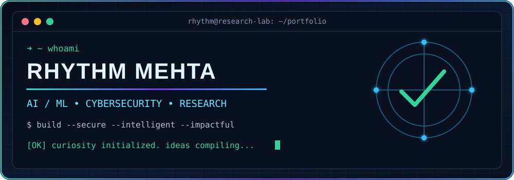

<!-- Rhythm Mehta • Developer Terminal Edition -->
<div align="center">



<br />

<a href="https://readme-typing-svg.demolab.com/demo/"></a>

<br />

[](https://rhythmm.dev)
[](https://www.linkedin.com/in/justrhythm/)
[](mailto:rhythmm.work@gmail.com)
[](https://github.com/rhythm298)


</div>

---

### `>_ whoami`

```yaml
name: Rhythm Mehta
handle: rhythm298
identity: Computer Science enthusiast | Builder | Aspiring researcher
focus:
  - Artificial Intelligence & Machine Learning
  - Cybersecurity & Ethical Hacking
  - Secure and meaningful software
ventures:
  - The Third Eye
  - Cluster it
current_mode: Learning • Experimenting • Building
open_to: Open source • Hackathons • Research collaborations
```

### `>_ cat mission.txt`

> **I don't just want to write code — I want to build technology worth trusting.**
>
> I'm exploring the intersection of AI/ML, cybersecurity, and practical software engineering. I enjoy turning challenging ideas into usable projects, collaborating at hackathons, and learning through experimentation. I'm also working on ideas around **The Third Eye** and **Cluster it**.

<table>
<tr><td width="50%" valign="top">

#### 🔭 `currently_building`
- AI/ML and cybersecurity projects
- Secure, intelligent software solutions
- Ideas for **The Third Eye** & **Cluster it**

#### 🌱 `currently_learning`
- Machine learning and applied AI
- Ethical hacking & security fundamentals
- DSA, Python, C++ and research methods

</td><td width="50%" valign="top">

#### 🤝 `collaboration_mode`
- Open-source projects with real-world value
- Research, hackathons and product experiments
- Teammates interested in ambitious startup ideas

#### 💬 `ask_me_about`
- Python and C++
- Problem solving and DSA
- AI/ML, cybersecurity and hackathons

</td></tr>
</table>

### `>_ ls ./toolkit`

**Core languages & web**


**AI, data & research**


`NumPy` · `Pandas` · `Matplotlib` · `Jupyter` · `Hugging Face`

**Backend, databases & developer tooling**


<details>
<summary><b>⚙️ More technologies I'm exploring</b></summary>
<br />

`Azure` · `GCP` · `Firebase` · `Kubernetes` · `LangChain` · `Ollama` · `Redis` · `GraphQL` · `Angular` · `Express`

*Technologies listed here are areas of experience or exploration, not a claim of mastery.*

</details>

### `>_ ./ventures --status=building`

| Initiative | Focus | Next step |
|:---|:---|:---|
| **The Third Eye** | Startup / product exploration | Add a public repository or product link when ready |
| **Cluster it** | Startup / product exploration | Add a public repository or product link when ready |
| **Open-source & research** | AI/ML, security and reliable systems | Explore collaborations and contribute code |

<details>
<summary><b>🧪 Developer philosophy</b></summary>
<br />

```text
$ git commit -m "stay curious"
[main] Keep learning, testing, improving.

$ ./principles
[✓] Build useful things
[✓] Keep security in the design
[✓] Learn in public
[✓] Collaborate generously
[✓] Ship, reflect, iterate
```

</details>

### `>_ github --analytics`

<div align="center">


<br />


</div>

### `>_ ./contributions --animate`

<div align="center">

<!-- This image appears after the supplied GitHub Action is run successfully. -->
<picture>
  <source media="(prefers-color-scheme: dark)" srcset="https://raw.githubusercontent.com/rhythm298/rhythm298/output/github-snake-dark.svg" />
  <source media="(prefers-color-scheme: light)" srcset="https://raw.githubusercontent.com/rhythm298/rhythm298/output/github-snake.svg" />
  
</picture>

</div>

### `>_ ./connect.sh`

<div align="center">

**Have a research idea, security challenge, or product worth building?**

[**📨 Send an email**](mailto:rhythmm.work@gmail.com) · [**🌐 Visit my portfolio**](https://rhythmm.dev) · [**💼 Connect on LinkedIn**](https://www.linkedin.com/in/justrhythm/)

<sub>⚡ Fun fact: I like transforming complicated problems into simple, useful solutions — ideally with fewer bugs than ideas.</sub>

<br /><br />

`</> built with curiosity, caffeine & commits`

</div>
